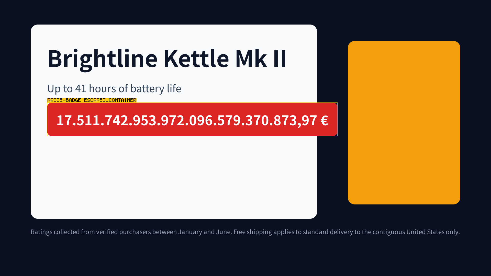
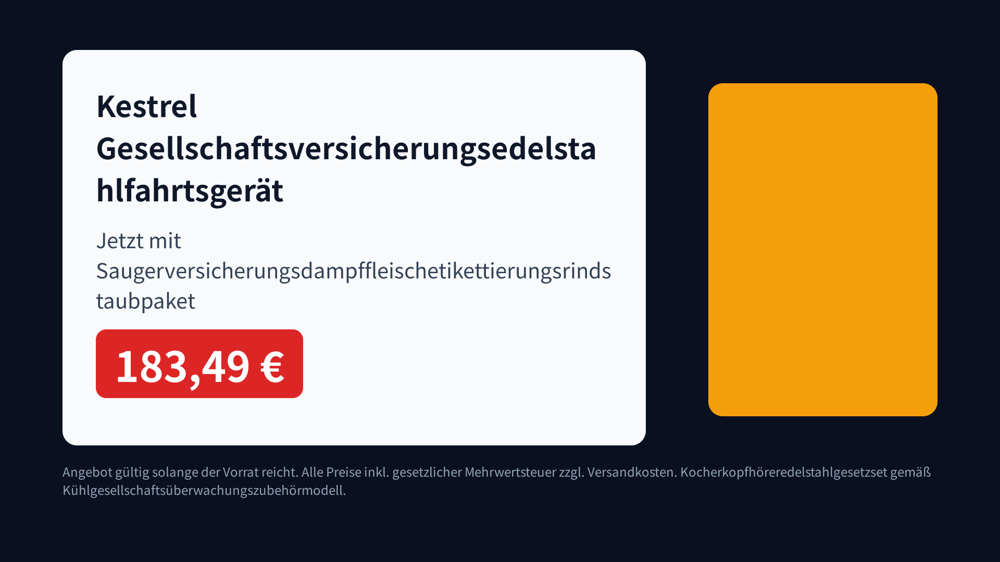
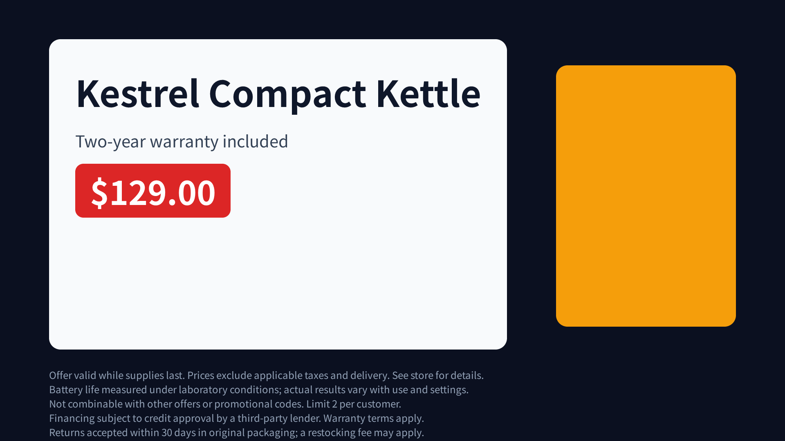

# Batch QA prototype — one template, 1,000 rows, every variant checked

Measured 2026-10-23 on this checkout (Bun 1.3.11, pin 66caf4e5 + 34 patches),
on an Apple M4 with 10 cores shared with other sessions. Every number below is
read out of `dist/batch-qa/run/summary.json`, which
`scripts/batch-qa/report.ts` computes from the run's `results.jsonl`; the
scripts that produced it are listed under "Reproducing".

## The thesis, and the answer

> An AI designs a template once; pocket-motion renders thousands of data
> variants deterministically and checks every one automatically.

**The thesis holds, with conditions.** It holds for rendering, for
determinism and for the checks the template was designed to be checked by.
It does not hold for anything about meaning, and some of what it holds for
it holds only because of choices in the template.

- **Rendering and determinism hold.** 1,000 rows went through in 2.25
  CPU-hours. 905 rendered to 825 distinct pictures. Every group of variants
  that shared an input identity also shared its frame digest and its
  verdict.
- **The automatic checks catch layout failures and empty mandatory fields.**
  `verify` failed 128 of the 905 rendered variants (14%). Each failure is
  real and is named by node and code; the frames are below.
- **Two checks cost ~4% of `verify` and catch the same 128.** They are a
  schema check, plus layout read at one frame. Neither can flag a variant
  `verify` passes. That is a property of this template; see "Per-request
  QA".
- **"Checks every one" needs two qualifiers.**
  - The template has to be built to be checkable: every field measured,
    every box that can be pushed named and fixed. Without that, things a
    reader would reject (tofu glyphs, a disclaimer line off the frame) pass
    every gate. Both are shown below.
  - The gates read geometry and visibility, never meaning or spelling. 85 of
    the 777 passing variants (11%) carry a word broken in the middle with no
    hyphen.

## Method

### The template

`scripts/batch-qa/template.ts` is a product card: a name, a one-line claim, a
price badge, and a disclaimer in a legal strip under the card, over a dark
ground with a decorative panel on the right. 1920×1080, 30 fps, 90 frames.
Every element enters in the first 900 ms (a slide, two rises, a pop and a
fade, all `both`) and holds to the last frame.

It is built the way `compositions/lower-third/gen.ts` is. Each field is
measured against the renderer's own advance table and fitted down a size
ladder at build time, because the core does not wrap:

| field | sizes | room |
| --- | --- | --- |
| name | 88 → 48 px | two lines |
| claim | 40 → 30 px | three lines |
| price | 80 → 52 px | one line, never wrapped |
| disclaimer | 24 px, fixed | four lines of a 1680×148 strip |

Whitespace is collapsed and trimmed first, as a template written against a
form would.

It differs from lower-third in one deliberate way: it does not refuse a row
that does not fit. lower-third throws; this template emits the smallest rung
and records what the fit predicted (`fit.predicted`). That lets the batch
compare the generator's own prediction with what the pixels show.

The sidecar states what the card is for, as seven `assertions[]`:

- the disclaimer dwells 60 frames and stays inside its box;
- the name and the price are in the picture from frame 30 to 89 and inside
  their boxes;
- the claim is inside its box.

The template lives in `scripts/`, not `compositions/`. Each variant is staged
into `dist/bqa-<sources>`, so neither ledger and no test discovers it, and
nothing in `src/manifest/spec.ts` or `render --spec` changed.

### The data

`scripts/batch-qa/rows.ts` generates the rows from a seed (20261023). The
generator is committed and the rows are not. `tests/batch-qa.test.ts` holds
the sha256 of the default output, so these numbers belong to one data set
anyone can rebuild:

| category | rows | what the rows hold |
| --- | ---: | --- |
| plain | 380 | what the template was designed against |
| long-name | 90 | names of 60-260 characters |
| german | 80 | compounds of 4-8 stems in name, claim and disclaimer |
| cjk | 100 | Chinese and Japanese with no spaces |
| mixed | 80 | Latin plus CJK, Cyrillic, Greek, Arabic, Hebrew, Thai, Devanagari, Hangul, emoji, combining marks, U+200B |
| empty | 50 | one or more fields empty or whitespace-only |
| price | 80 | 10-40 digits in five group conventions |
| long-disclaimer | 60 | 4-14 sentences of legal copy |
| duplicate | 50 | an earlier row's content under a new id |
| near-duplicate | 30 | an earlier row with whitespace added |

### The runner

`scripts/batch-qa.ts` runs each row in its own process
(`scripts/batch-qa/variant.ts`), `--jobs` at a time:

1. **fit** — open the measurer against a metrics-only bake of the whole data
   set's charset, then fit the four fields. The bake is built once: 1.0 s
   wall, 1.3 s CPU, 316 KB. A codepoint the face does not carry is a
   refusal here, before any build.
2. **stage** — write the five sources to
   `dist/bqa-<first 16 hex of their sha256>`. Equal sources stage at one
   path, behind a lock.
3. **build** — `runBuild`, the one place this repository spawns a build, so
   every variant has its `build.json`.
4. **identity** — `computeIdentity`, called exactly as `trace` calls it.
5. **render** — every frame is rendered and SHA-256 hashed. Every 50th row
   is also encoded to H.264.
6. **qa** — `verify`'s `run()`, in process. Its sections are the
   sub-commands' own JSON, so the gates are the repository's and not a
   copy.
7. **evidence** — for failures, an annotated PNG of the last frame a gated
   finding was read at.

The staged tree is then deleted, and no frame is kept. The parent records
each process's rusage, which on darwin includes the build it spawned and
waited for (checked: a grandchild's 2.2 s of CPU appears in the child's
`cpuTime`). So CPU time and peak RSS are per variant, without sampling.

**What fails a variant** is decided in one place, `judge` in
`scripts/batch-qa/variant.ts`, which is tested. A variant fails on any of:

- a `verify` section whose own verdict is false (lint, realm, keyframes,
  visibility, assertions);
- a failing assertion;
- an active layout finding with one of six codes: `text_box_overflow`,
  `clipped_text`, `panel_out_of_canvas`, `content_overlap`,
  `escaped_container`, `text_occluded`.

`text_not_painted` is reported and not gated. Every field fades in, so every
node carries it at frame 0: 5,878 such findings over the run. Whether the
disclaimer is on screen long enough is what its `dwellFrames` assertion
asks. `verify --strict` counts `text_not_painted`, which every rendered
variant carries at least six times, so it would fail all 905.

### Every frame, or a sample: a sample

A pilot ran 90 rows stratified over the categories. Each was checked twice:
by `verify`'s default grid, and by every one of its 90 frames. The
every-frame check runs `verify` with a layout read at all 90 frames, plus
`visibility` and `assert` at `--samples 90`.

| | sampled (`verify` default) | every frame |
| --- | --- | --- |
| frames read | layout at 0, 22, 45, 67, 89; visibility and assert at 24 | all 90, for all three |
| rendered variants | 82 | 82 |
| verdict agrees | 82 | — |
| code set agrees | 82 | — |
| QA CPU per variant, mean | 5.9 s | 42.4 s |

The two agree on every verdict and every code, and every-frame costs 7.2×
as much. **The batch therefore used `verify`'s default grid.**

This is a property of this template: its failures are geometry that holds
from the end of the entrance to the last frame. A template whose fields
move during the film can be wrong for fewer frames than the stride. Then
the sample misses it, and only `--samples durationFrames` reads it.

### The machine, and the two segments

The run was made in two segments, and `--resume` kept the first one's
results:

| segment | rows | jobs | load average | process wall per variant, p50 | CPU per rendered variant, p50 |
| --- | ---: | ---: | --- | ---: | ---: |
| 0 | 111 | 8 | 40-400 | 91 s | 8.5 s |
| 1 | 889 | 4 | 4-21 | 7.7 s | 8.7 s |

In segment 0, other sessions were rendering, swap was nearly full, and the
run was stopped on purpose. Segment 1 ran on a quiet machine. **CPU time per
variant moved by 2% between them while wall time moved twelvefold**, so CPU
times from both segments are comparable, and wall-clock numbers come from
segment 1 only. The throttle (drop to 2 jobs above load 20 for 30 s, or when
swap grows by 1 GiB) never fired in segment 1.

## Numbers

### Verdicts

| category | pass | fail | refused |
| --- | ---: | ---: | ---: |
| plain | 380 | 0 | 0 |
| cjk | 100 | 0 | 0 |
| german | 80 | 0 | 0 |
| long-name | 72 | 18 | 0 |
| long-disclaimer | 36 | 24 | 0 |
| price | 26 | 36 | 18 |
| empty | 5 | 45 | 0 |
| mixed | 10 | 0 | 70 |
| duplicate | 44 | 3 | 3 |
| near-duplicate | 24 | 2 | 4 |
| **all** | **777** | **128** | **95** |

The five empty rows that pass have only their claim empty, and the claim is
optional by design.

### Why variants failed

| code | variants |
| --- | ---: |
| `content_overlap` on the price badge | 50 |
| `escaped_container` on the price badge (it leaves its row) | 39 |
| `content_overlap` with the decorative panel | 30 |
| `assert` disclaimer `dwellFrames` (empty disclaimer) | 26 |
| `escaped_container` on the disclaimer (it leaves its strip) | 24 |
| `assert` disclaimer `insideBox` | 24 |
| `assert` price `inPicture` (empty price) | 21 |
| `escaped_container` on the price row (it leaves the card) | 20 |
| `assert` name `inPicture` (empty name) | 14 |

By family: 83 variants carry `escaped_container`, 69 a failing assertion and
50 `content_overlap`. **45 fail on assertions alone**; they are all the
empty-field rows, and their pictures have no geometric fault. No variant
produced `text_box_overflow`, `clipped_text`, `panel_out_of_canvas` or
`text_occluded`. Every text sits in a box that grows with it, so what
overflows here is a box leaving its parent, never ink leaving its own box.

### Refusals: 95 rows the face cannot draw

Noto Sans SC, the declared face, lacks:

- **Currency signs:** U+20B9 ₹ (18 rows), U+20BD ₽ (7).
- **Emoji:** 🔥 (17), 🎧 (11).
- **Latin Extended-A letters:** İ (11), Ł and ź (7), which refuse
  `İstanbul` and `Łódź` in an otherwise Latin name.
- **Scripts:** all of Thai (9), Arabic (8), Devanagari (8), Hangul (7) and
  Hebrew (5).
- **U+200B** (8).

Each refusal cost 0.15 s of CPU and no build. 70 of the 80 mixed-script rows
were refused, and the 10 that rendered mix only scripts the face carries.

### The generator's own prediction against the pixels

| | pixels fail | pixels pass |
| --- | ---: | ---: |
| generator says a field will not fit | 83 | 60 |
| generator says everything fits | 45 | 717 |

- **The prediction is wrong in both directions.** Precision is 58% and
  recall 65%.
- **60 false alarms.** 53 of them are long names that exceed their own
  two-line budget while the card still has room, because a one-line claim
  leaves two lines spare.
- **45 misses.** All of them are empty fields, which a fit does not
  consider a failure.

A batch that trusted the generator's self-report would have refused 60
correct variants and shipped 45 broken ones.

### Cost per variant

Segment 1, CPU time per rendered variant (803 variants), from each process's
rusage:

| step | CPU, p50 | wall, p50 | share of variant CPU |
| --- | ---: | ---: | ---: |
| fit (measurer boot and fit) | 77 ms | 54 ms | 1% |
| build (child process) | 1.81 s | 1.32 s | 21% |
| identity | 16 ms | 16 ms | — |
| render, 90 frames, SHA-256 | 0.70 s | 0.63 s (7.0 ms/frame) | 8% |
| **`verify`** | **5.94 s** | **5.51 s** | **68%** |
| whole variant | 8.66 s (mean 8.86, p90 9.97, max 15.0) | 7.68 s | |

- **QA costs a median 8.5× the render** (p90 9.1×), and 68% of everything a
  variant costs.
- **Encoding the delivery is the other large cost.** It adds 3.6 s of
  ffmpeg CPU per variant (19 encoded, H.264 1920×1080, 250 KB at the
  median). So one delivered variant costs about 12 CPU-seconds, half of it
  QA.
- **Peak RSS per variant is 586 MiB at the median.** That number is the
  build: baking the Noto Sans SC atlas peaks at ~650 MiB on its own. The
  variant process itself peaks at 314 MiB (max 435). Variants that also
  encode reach 823 MiB, which is ffmpeg.
- **Disk high-water was 25 MiB**, sampled every 2 s by `du` over the run's
  own directories. That covered 4 staged trees (pak 2.3 MB at the median,
  5.3 MB max; bundle 185 KB), the measurement cache, 19 videos (5.7 MB) and
  the evidence PNGs (3.3 MB).
- **Throughput was 32.4 variants per minute** with 4 jobs (889 in 27.4
  minutes).
- **Projection.** At 8.9 CPU-s per variant, 10 dedicated cores bound the
  rate at ~67 per minute; without `verify`, at ~2.8 CPU-s, ~210. This is
  arithmetic, not a measurement: the M4's six efficiency cores are slower
  than its four performance cores.

### Where `verify`'s time goes

`scripts/batch-qa/qa-cost.ts` on one staged variant, each section called
alone five times in a warm process on the quiet machine, CPU ms median:

| section | CPU ms |
| --- | ---: |
| render, 90 frames (for scale) | 485 |
| lint | 1 |
| realm (`check`) | 43 |
| keyframes | 4 |
| visibility, 24 frames | 936 |
| layout, one frame at the hold | 164 |
| layout, five frames | 784 |
| assert, 24 frames | 1,979 |
| **`verify`** | **3,733** |

Inside the batch, `verify` runs once in a fresh process. It costs 5.9 s
there against 3.7 s warm; the difference is start-up. Nearly all of the cost
is two sweeps over the same 24 frames that hide every named or text node and
re-render: `visibility` (once per node), and `assert`, which also computes
every layout code at each of those frames. `verify` then boots five more
times to compute layout codes at five frames, which the `assert` sweep has
already computed and dropped. The cost scales with sampled frames × nodes;
this card has nine reportable nodes.

### Deduplication

| key | distinct | collapses |
| --- | ---: | --- |
| rows | 1,000 | |
| raw field content | 950 | the 50 planted duplicates |
| content after the template's whitespace cleaning | 913 | the 30 near-duplicates, and 8 all-blank rows that clean to one card |
| rendered (not refused) | 905 | |
| staged sources | 825 | |
| input identity | 825 | |
| frame digest | 825 | |

- **The keys agree.** Sources, identity and frames are one-to-one here: 73
  identity groups have more than one member, and no group disagrees on
  frames or verdict. The 80 redundant variants are 47 duplicates, 26
  near-duplicates and 7 of the 8 all-blank rows.
- **What deduping would save.** Re-rendering and re-checking them cost 530
  CPU-s, and 687 s with their builds: 8% of the run.
- **The keys are not equal in cost.** Identity is known only after the build,
  so it saves render and QA. A key over the staged sources saves the build
  too, and a key over the cleaned row saves the fit as well.

**Identity dedupes only because the staging path is content-addressed.** The
same row was built under a second prefix three times. Each time the frame
digest was equal and the identity was not: `bundle` and `toolchain` differ,
because the bundle carries repo-relative module paths
(`dist/bqa-…/app.tsx`) and `build.json`'s argv names the staging directory.
A runner that stages into a per-job temporary directory, as
`render --spec` does, gives every row its own identity.

## What the checks caught that a skim would miss

- **A missing mandatory disclaimer, in a picture with nothing wrong in it.**
  The name, claim and price are all in place, and the strip under the card
  is simply empty. 26 variants; the dwell assertion is what says so:

  

  The same goes for an empty price, which leaves a red badge with nothing in
  it (21), and an empty name (14).

- **A disclaimer too long for its strip.** It runs past the strip's bottom
  edge, and its last line is cut by the frame. A reader sees grey small print
  that seems to continue; nothing says a sentence is missing.
  `escaped_container` names it (24 variants):

  

- **A price that leaves its row and its card.** It ends 144 px past the row
  and almost reaches the decorative panel; in 30 others it overlaps the
  panel. A badge wider than the card reads as a design choice at thumbnail
  size:

  

- **A price row pushed out of the bottom of the card** by a name of seven or
  eight lines: 40 px or 110 px, 20 variants. It overlaps the top of the legal
  strip, which reads as a deliberate layered layout at a glance. Names of five
  and six lines pass, because a one-line claim leaves two lines of the card
  free. The pixels know that; the generator's per-field budget does not.

## What they cannot catch

Each of these was built and checked, not reasoned about.

- **A word broken in the middle.** `wrapLines` breaks a segment wider than
  its box by grapheme cluster and adds no hyphen. "Edelstahl" here becomes
  `Edelsta` / `hl`. **85 of the 777 passing variants** carry at least one
  such break (79 German rows and 6 duplicates of them). The template counts
  them (`fit.*.brokenWords`) because nothing downstream reads spelling:

  

- **Tofu, if the template does not measure.** The build bakes the tofu cell
  for a codepoint the face lacks and exits 0. In
  `scripts/batch-qa/blind-spots.ts`'s `tofu` case, every field carries
  Hangul, Arabic, Devanagari, Thai, U+20B9, U+200B or an emoji. Every field
  fits its box, and the variant passes every gate:

  

  The batch never ships this, because `fit` refuses those 95 rows. But the
  refusal is the measurer's (`src/text/measure.ts` refuses an unbaked
  codepoint), not any pixel gate's. A template that skips measuring one
  field — a price it assumes is digits — loses the only check there is.

- **A line that leaves the canvas.** Layout clamps every box to the viewport
  before anything reads it (`src/render/findings.ts`, `collapsedAtEdge`).
  In the `offcanvas` case the disclaimer is anchored to the canvas instead
  of its strip and runs six lines from y = 900. The sixth line is below the
  frame and layout reports `120,900 1680x180`. No code fires, and all seven
  assertions hold:

  

  This is why the template puts the disclaimer in a fixed strip: a box that
  is not the canvas is one `escaped_container` can compare against.

- **A box nobody named.** `escaped_container` reports only nodes with a name
  or text. In the template's first version the price row was an unnamed
  wrapper, and a seven-line name pushed it 40 px out of the card with no code
  against it. The overflow surfaced only as the badge's `content_overlap`
  with the strip below.

- **What a box does not contain.** Overlap is decided on boxes, not ink. A
  glyph run that draws over the decorative panel without its box reaching
  it is one finding (`text_box_overflow`) on the run. It is never a
  `content_overlap` with the panel.

- **Anything about meaning.** The gates read geometry and visibility, so all
  of these pass:
  - a wrong price, or a negative one (`-$4,000,…`);
  - the wrong disclaimer;
  - a claim the product does not support;
  - a 40-digit price, as long as it fits.

  Contrast is the same: `covered` takes in a run drawn in exactly the colour
  under it (`src/render/visibility.ts`), and one unit away from that colour
  it is "in picture".

- **Anything between samples**, on a template whose failures move. See "Every
  frame, or a sample".

## Per-request QA: cheap checks, and when the full sweep is still needed

Another session porting hajibang's top-reveal measured `verify` at about 4
minutes for a 55 s video. Its conclusion was that per-request QA has to come
from cheap checks computed while laying out, with full `verify` kept for
template changes. In this data:

**The sweep's cost is per node, not per second.** `verify` costs 5.9 CPU-s
on a 9-node, 3-second card. Its two sweeps read a fixed 24 frames, so a 55 s
video costs minutes only if it carries many more reportable nodes.

**A cheap tier catches everything `verify` caught here, with no false
alarms.** It has two parts:

- *Schema:* name, price and disclaimer are non-empty after cleaning. This
  needs no render and catches all 45 empty-field failures.
- *One layout frame at the hold:* this catches all 83 geometric failures.
  It costs 164 ms of CPU, which is 4.4% of `verify` warm.

| check | catches, of 128 | flags passing variants | CPU |
| --- | ---: | ---: | --- |
| generator's fit prediction | 83 | 60 | free |
| schema | 45 | 0 | free |
| one layout frame at the hold | 83 | 0 | 164 ms |
| schema + one layout frame | **128** | **0** | 164 ms |
| full `verify` | 128 | — | 3.7-5.9 s |

Nothing in the run was caught only by the full sweep.

**I agree with the conclusion, with three amendments.**

1. **The cheap tier is cheap because of how the template was designed,
   not because laying out is cheap.**
   - Its fields hold still after 900 ms, and every pushable box is fixed
     and named, so one frame at the hold carries every failure.
   - A template whose failures happen mid-motion would need the sweep, and
     only a measurement like the pilot can say which kind a template is.
   - So the cheap tier should be accepted per template, once, by running
     both on a sample and comparing. That is what the pilot did for this
     one.
2. **"Computed while laying out" is not available yet in this engine.** A
   node's box is read by rendering the frame with the inspector latch set,
   one raster per node, so one layout frame is ~10 renders here. A check
   that is truly free at layout time needs the core to hand back every rect
   from one layout pass. That is an engine change, and it would also take
   most of the cost out of `assert`'s sweep.
3. **Keep the full sweep on a sample of production variants, not only on
   template changes.**
   - Data can reach a state the template change never exercised; here, a
     price long enough to leave the card.
   - The sweep is what would notice the cheap tier going blind on such a
     state.
   - In money it is affordable at batch scale: full `verify` is 1.7
     CPU-hours per 1,000 variants.
   - The case for the cheap tier is latency per request (seconds against
     minutes on a long video), not compute cost.

## Verdict

Rendering many variants of one template deterministically and checking each
one automatically works, at the cost measured here: ~9 CPU-s and ~600 MiB per
variant, two thirds of it QA. The checks find the layout failures real data
produces, and a missing mandatory field that a person skimming would not see.
They agree with themselves across every duplicate.

What the claim needs, to stay true:

- **A template designed to be checked:** every field measured, every
  pushable box fixed and named, mandatory fields stated as assertions.
- **A face that covers the data.** Here the declared face refuses ₹, ₽,
  Ł and İ before the data reaches any check.
- **A human or a semantic check for meaning and spelling.** One variant in
  nine that passes every gate has a word broken in half.

"Nobody can watch every variant" is true. Nobody needs to watch for what
these gates read; somebody still has to check what they do not read.

## Reproducing

The full run; about 30 minutes with 4 jobs on a quiet machine:

```bash
bun scripts/batch-qa.ts --out dist/batch-qa/run --jobs 4 --path-probe 3
```

```bash
bun scripts/batch-qa/report.ts dist/batch-qa/run
```

The two blind spots:

```bash
bun scripts/batch-qa/blind-spots.ts
```

The pilot passes the 90 stratified ids with `--only` and `--exhaustive-every
1`; `--resume` continues a stopped run. `scripts/batch-qa/qa-cost.ts` takes a
variant staged by `scripts/batch-qa/variant.ts --keep`.

## Open

- **One sweep instead of three.** `verify` computes the layout codes inside
  `assert`'s sweep, drops them, and boots five more times to compute them
  again. Returning them from that sweep would take ~0.8 of 3.7 CPU-s off
  every variant without changing what is read.
- **Rects from one layout pass.** Every box costs a raster today; see
  amendment 2.
- **Identity across staging paths.** Identity names the staging directory
  through the bundle's module paths and the recorded argv. A content-
  addressed path works around it here, while `render --spec`'s temporary
  directories do not.
- **Hyphenation.** `wrapLines` has no hyphenation at all, so a compound
  wider than its box is broken without a mark.
