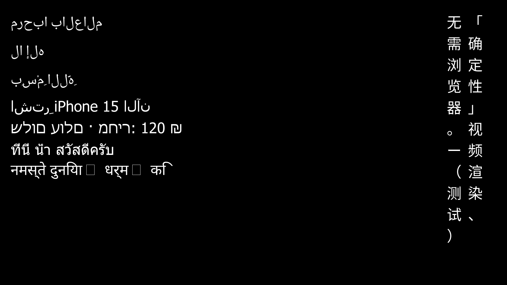
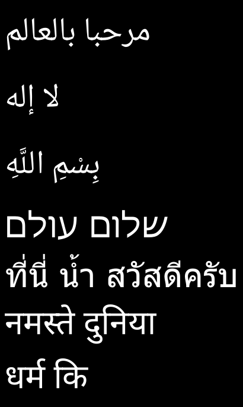
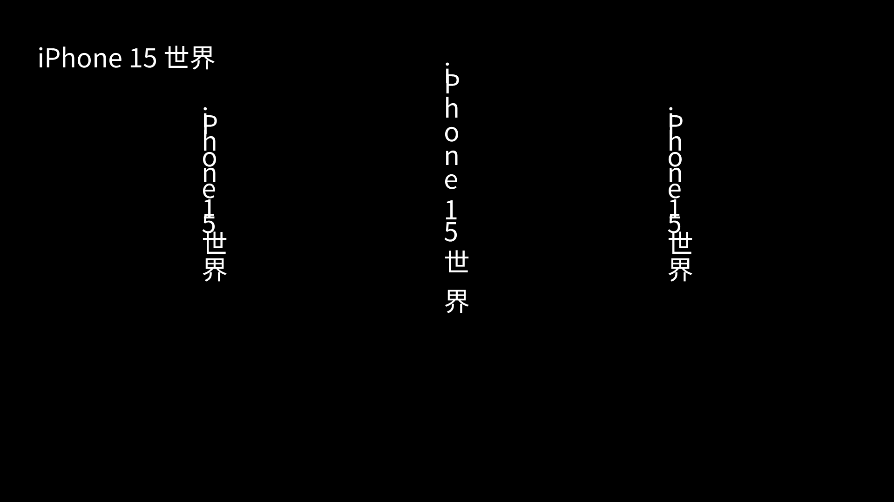
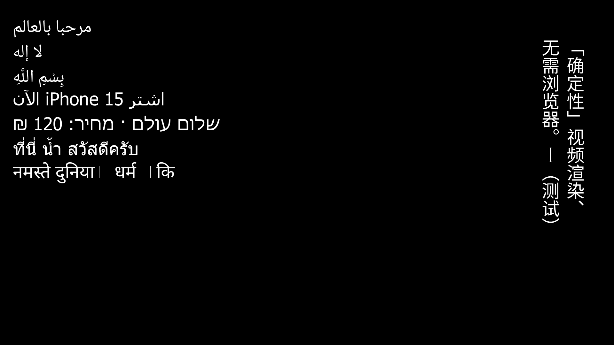
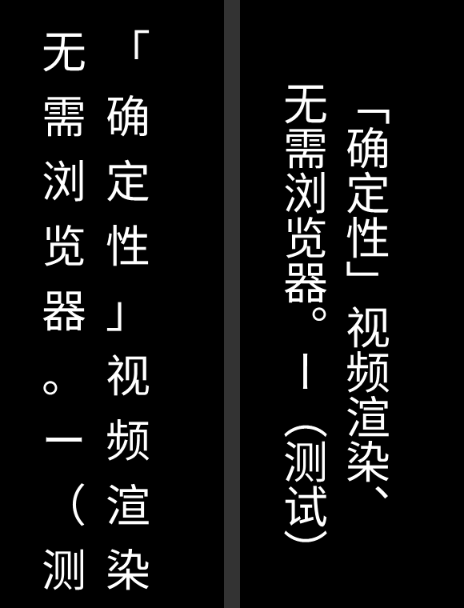

# Complex scripts, vertical text and fit-to-box — design

Design and prototype, 2026-10-23. Nothing under `patches/` or `vendor/`
changes here. The prototype is four files: `src/text/shape.ts` (a shaper
loader), `scripts/shape-probe.ts` (the determinism corpus),
`scripts/shape-render-probe.ts` (shaped runs drawn by the unmodified core) and
`tests/shape.test.ts`. The figures are in [`text-shaping/`](text-shaping/).
The last section lists the patch-sized steps that would follow, each with the
guard that has to go red without it.

## What it is for

The product direction is a template designed once and rendered for many data
variants, each variant checked by `layout`, `visibility` and `assert` with no
person looking at it. The likely first markets are e-commerce and
multilingual B2B video. Text is the first thing that direction reaches that
the renderer cannot do: Arabic, Hebrew, Thai and Devanagari render wrongly,
there is no vertical CJK, and fitting variable-length copy into a box is
written again in every generator.

A variant pipeline makes a rendering defect worse than a film does, because
nobody looks at variant 3,000. So each capability below is judged by two
questions from `AGENTS.md`: is every input that moves its pixels declared,
and can a gate see it when it goes wrong.

## Inputs the prototype used that are not in the repository

Every one is a file that was already on this machine; nothing was downloaded.

| file | from | sha256 |
|---|---|---|
| `hb.wasm` (HarfBuzz 14.0.0) | npm `harfbuzzjs@0.10.3`, checked against pnpm's sha512 record of the tarball | `ea319787…f00d6d` |
| `hb.wasm` (HarfBuzz 12.3.2) | npm `harfbuzzjs@0.10.0` | `d2ab9751…83a6d0` |
| `NotoSansArabic-Variable.ttf` (OFL) | `harfbuzzjs@0.10.3/test/fonts/noto/`, sha512-checked as above | `ee489b99…102c56` |
| `NotoSansDevanagari-Regular.otf` (OFL) | same directory | `4775b7ee…d9ac7` |
| `NotoNaskhArabic-Regular.ttf` (OFL) | a Flutter engine checkout's test fonts | `6b999662…cf9f5` |
| `Tahoma.ttf` | macOS `/System/Library/Fonts/Supplemental` — evidence frames only, never committable | `359413e7…17fbb` |
| `bidi-js` 1.0.3 (MIT, UAX #9 at Unicode 13.0.0) | Bun's install cache | — |
| `hb-shape` / `hb-view` 14.2.1 | Homebrew, used as the reference renderer | — |

## 1. The text path today

1. **Class literal to slot.** `text-[Npx]`, `font-bold` and `font-[face]`
   resolve to a font slot (`fontSlotInfo`, `framework/compiler/tailwind.ts`;
   dynamic slots from `patches/0001`, named faces from `0016`). A slot is a
   (face, weight, px) triple. Nothing in a class literal names a language,
   a script or a direction.
2. **Characters to bake.** Pass 1's collector (`makeCollector`,
   `framework/compiler/jsx-plugin.ts:302`) adds the codepoints of **every
   string literal in the module** to one set, and ASCII 32–126 is always added.
   The set is global: every slot bakes every collected codepoint its face
   maps.
3. **Bake.** `bakeSlot` (`framework/compiler/bake-font.ts:428`) maps each
   codepoint through the face's cmap with opentype.js, rasterises the outline
   into a cell of the slot's uniform size (width = the widest glyph's ink),
   rounds the advance to a whole logical pixel (u8) and the left-bearing shift
   to another (u8), and reads GPOS **pair** adjustments only (lookup type 2,
   `extractGposPairs`), rounded to i8 px (`patches/0009`). GSUB is never read.
   No GPOS lookup other than pair kerning is read, so there is no mark
   positioning and no cursive attachment. No step knows about direction.
4. **Atlas.** FONT ATLAS v4 (`contracts/spec/spec.ts`): a 16-byte header
   (byte 15 reserved), a cmap of 8-byte entries sorted by codepoint
   (`u32 codepoint, u16 gid, u8 advance, u8 xoff`), coverage, then the kern
   pairs.
5. **Layout.** `Fonts::measure_run` and `Fonts::layout_run`
   (`engine/core/src/text.rs:376`, `:533`) walk `text.chars()` in logical
   order, one cmap lookup per scalar, pen moving left to right, a line break
   only at `'\n'`. A miss draws gid 0 and bumps a counter.
6. **Draw.** `emit_text` (`engine/core/src/draw.rs:3221`) emits one
   **GLYPH_RUN**: slot and count, colour, then per glyph the cell's top-left
   as a rounded i16 pair and the atlas gid. Cells are axis-aligned by contract.
   An axis-aligned scale takes resampled glyph pages instead. A rotated or
   skewed run moves its anchors and keeps every cell upright and unscaled.
7. **Host.** Line breaking and fitting happen in generators
   (`src/text/fit.ts`, `src/text/measure.ts`), against the core's own
   `measureText`, with `Intl.Segmenter` deciding where breaks may go.
   `layout`'s `text_box_overflow` and `clipped_text` compare a node's ink, in
   pixels, against its box and its container (`src/render/findings.ts`).

The draw op is the useful finding here. GLYPH_RUN already carries a
positioned list of glyph ids; the core's own line model is what produces the
wrong positions. Section 4 renders shaped text through the unmodified op.

## 2. What breaks today, measured

The same strings, drawn by the baked path (`today-unshaped.png`, top) and by
`hb-view` from the same font files (`reference-hb-view.png`, bottom):





What shaping changes, per string, read from HarfBuzz's output against the
face's cmap (Arabic in Noto Naskh Arabic, Hebrew and Thai in Tahoma,
Devanagari in Noto Sans Devanagari):

| string | script | code points | glyphs shaped | glyph is not the cmap glyph | moved by a GPOS offset | visual order reversed |
|---|---|---:|---:|---:|---:|---|
| مرحبا بالعالم | Arab | 13 | 13 | 12 | 0 | yes |
| لا إله | Arab | 6 | 5 | 3 | 0 | yes |
| بِسْمِ اللَّهِ | Arab | 14 | 11 | 5 | 5 | yes |
| שלום עולם | Hebr | 9 | 9 | 0 | 0 | yes |
| ที่นี่ น้ำ สวัสดีครับ | Thai | 21 | 22 | 5 | 9 | no |
| नमस्ते दुनिया | Deva | 13 | 11 | 3 | 0 | no |
| धर्म कि | Deva | 7 | 6 | 2 | 0 | no |

What each failure looks like in the frame:

- **Arabic**: every letter in its isolated form, letters in logical order drawn
  left to right, so each word reads backwards and nothing joins. لا is two
  glyphs instead of the lam-alef ligature. Harakat sit after their letters
  instead of over or under them.
- **Hebrew**: no contextual forms are involved (0 substitutions), and every
  word and the sentence still read backwards. Order is the whole defect.
- **Thai**: tone marks over upper vowels are not lifted (ที่ draws the tone
  mark inside the vowel's ink, so it reads ที), and น้ำ is not decomposed
  into nikhahit, tone mark and sara aa.
- **Devanagari**: no conjuncts (स्ते draws a visible virama), no reph
  (र्म), and the i-matra of कि is drawn after the consonant instead of
  before it.
- **Mixed Arabic and Latin** (`اشترِ iPhone 15 الآن`): each Arabic word
  is reversed, and the two Arabic words are on the wrong sides of the Latin
  run, because the line is drawn in logical order from the left.

Two text layouts that a template would ask for are not shaping defects and
are measured separately:

- **A rotated `Text` keeps upright cells.** `today-rotated.png` draws
  `iPhone 15 世界` at `rotate-90`, at `rotate-90 scale-150`, and inside a
  rotated parent. In all three the anchors walk down the turned baseline by
  each glyph's *horizontal* advance and every glyph stays upright, so Latin
  letters overlap. AUTHORING.md says a rotated run keeps its cells at the
  baked size; it does not say the glyphs do not turn.

  

- **Vertical CJK today** is one character per line (`'\n'` between them).
  That puts every punctuation mark in its horizontal form and position, and
  steps by the face's line height — 81 px at 56 px for Noto Sans SC, 1.45 em
  — instead of 1 em. Left half of `vertical-today-vs-shaped.png` (section 6).

## 3. Shaping: the options

### What a shaper reads

Measured with the prototype, every one of these moved glyphs:

- **text, and the font bytes**: the corpus digest changes with either.
- **direction**: مرحبا shaped LTR instead of RTL picks different glyphs, not
  only a different order (logical-first letter: gid 764 LTR, 766 RTL).
- **language**: `۴۵۶۷` under `ur` gives gids 1143, 1205, 348, 353 and under
  `ar`, `fa` and `sd` gives 1142, 1206, 348, 352 — three of four digits take
  their Urdu forms, through `locl`.
- **features**: `-rlig` turns لا إله from 5 glyphs into 6.
- **variation coordinates**: `wght` 400, 550.5 and 700 give three different
  advance lists for the same string in Noto Sans Arabic Variable.
- **the shaper's own version**: HarfBuzz 12.3.2 (wasm), 14.0.0 (wasm) and
  14.2.1 (native, Homebrew) agree on all 7 corpus strings. Seven strings
  agreeing is not a claim that versions agree in general: HarfBuzz changes
  output between releases when it fixes a script, so the version is an input
  and has to be pinned.

So the declaration a shaped run needs is (shaper bytes, font bytes, text,
direction, script, language, features, variation coordinates). Direction and
script cannot be left to guessing without making the guess the input.

### A — shape at build time, in the baker

The baker shapes each run with a pinned wasm shaper, bakes cells for the glyph
ids the runs use (contextual forms, ligatures and conjuncts have no codepoint),
and writes a table of positioned runs into the pak. The core looks a line up
in the table and places glyphs from it. GLYPH_RUN does not change.

- **Determinism**: the shaper is a wasm module whose only host imports are
  five functions that throw or grow memory (section 4), run under the Bun
  version `build.json` already records. Measured identical across two processes and across
  darwin-arm64 and linux-x64, including variable-axis shaping.
- **Atlas size**: only the glyphs the runs use. The three Arabic corpus
  strings use 19 glyphs; their codepoints' GSUB closure is 59.
- **Patch class**: upstream. It is declaration-layer work and
  target-independent: a PSP draws a positioned GLYPH_RUN as it draws any
  other.
- **Identity**: the shaper's sha256 enters `build.json` and so the
  `toolchain` component; the shaped runs are in the pak, so the `pak`
  component moves when they do. A composition with no shaped face bakes
  byte-identical atlases.
- **Reach**: only strings known at build time. For a mount-only composition
  that is every string — see the recommendation.

### B — shape in the core

The core carries a shaper (harfrust or rustybuzz compiled into
`engine/core`), the pak carries each face's GSUB/GPOS/GDEF, and every string
is shaped at layout.

- **Determinism**: also wasm, also fine.
- **Atlas size**: the core can be handed any string, so the atlas has to
  carry every glyph any string over the charset could produce: the GSUB
  closure. Measured with `hb-subset` at 56 px, density 1, one slot, cells at
  the uniform width the baker uses:

  | glyph set | glyphs | cell | coverage bytes |
  |---|---:|---|---:|
  | Arabic corpus, cmap only | 18 | 54×96 | 93,312 |
  | Arabic corpus, GSUB closure | 59 | 58×96 | 328,512 |
  | Arabic block U+0600–06FF, cmap only | 283 | 106×96 | 2,879,808 |
  | Arabic block, GSUB closure | 718 | 106×96 | 7,306,368 |
  | Devanagari corpus, cmap only | 15 | 44×73 | 48,180 |
  | Devanagari corpus, GSUB closure | 89 | 85×73 | 552,245 |
  | Devanagari block U+0900–097F, closure | 623 | 89×73 | 4,047,631 |

  7.3 MB for one Arabic size at 1×, four times that at `supersample: 2`, per
  size and weight. The uniform cell is part of the cost: the widest glyph in
  the closure (a reph-plus-i-matra form in Devanagari) sets every cell's width.
- **Patch class**: motion, or a feature upstream will not take. Upstream's
  targets include an ESP32 and a PSP, and upstream's own plan
  (`docs/TEXT_RESOURCES.md`, `docs/TEXT-OFFLOAD.md`) puts shaping in a
  separate Rust text service (`engine/crates/pocket-text`: cosmic-text 0.19,
  harfrust 0.5.2, unicode-bidi 0.3.18) run off the UI core, never in it.
- **Identity**: fine, it is all in the core and the pak.
- **Reach**: every string. That is the only thing B buys, and a mount-only
  composition does not need it.

### C — pre-shaped runs from the host

Two forms, and they differ on the one criterion that matters here.

- **C1, a platform shaper** (CoreText, DirectWrite, the system's HarfBuzz —
  upstream's TEXT_RUN path for native hosts): the shaper's version is
  whatever the OS ships, so it is an undeclared input by construction.
  Ruled out by the first invariant.
- **C2, the pinned wasm shaper run by the host at mount**: as deterministic as
  A and reaches strings computed at mount. But it moves the shaper into the
  render path, and the cells have to exist before the frame, so it needs
  either the closure atlas of B or host-side rasterisation of missing glyphs at
  mount — a second rasteriser in the render path, which `check` and the frame
  hash would treat as part of the core without it being the core.

### Recommendation: A, with the run inventory read from the mounted tree

A's limit is "strings known at build time". A pocket-motion composition is
mount-only — `check` fails one that issues a guest op after mount or books
work for later — so **every `Text` it will ever draw exists, with its final
content and its slot, in the tree right after mount.** The build can boot the
bundle once, read every text node's content and style from that tree,
shape exactly those lines, and bake. Nothing has to be pieced together from
the AST: a string passed through props, concatenated or produced by a
generator arrives in the inventory the same way a literal does.

So the plan is: the baker learns to shape a declared list of runs (upstream
class), and pocket-motion's build produces that list by mounting (motion
side, in `src/cli/build.ts`). The inventory is derived from the bundle by a
deterministic boot, so it adds no input; it is still written beside the pak
and hashed, so a reader can see what was shaped.

## 4. The prototype

### A shaper that cannot read the host

`src/text/shape.ts` instantiates harfbuzzjs's `hb.wasm` without its
emscripten glue. The module imports five host functions:
`wasi_snapshot_preview1.proc_exit`, `env._abort_js` and `env._setitimer_js`
throw, `env._emscripten_runtime_keepalive_clear` does nothing, and
`env.emscripten_resize_heap` grows linear memory. None returns host state, so
no clock, locale, file or environment variable can reach the output.
`openShaper` refuses a module importing anything else; `tests/shape.test.ts`
holds that with a hand-assembled module importing `env.now`, and goes red with
the check removed. Language is always passed, because a native HarfBuzz falls
back to `setlocale()` for it.

Positions come back in font units (`hb_font_set_scale(upem, upem)`), so the
shaper's output is integers before any pixel size is applied. The canonical
form of a run is six little-endian i32 per glyph — gid, cluster, x advance,
y advance, x offset, y offset — after the upem.

### Bit-identical across runs, processes and platforms

`bun scripts/shape-probe.ts` shapes 7 strings (Arabic joining, lam-alef,
harakat, Arabic-Indic digits, Persian, two Devanagari lines) and prints a
digest over the canonical bytes:

| run | corpus digest |
|---|---|
| darwin-arm64, Bun 1.3.11, process 1 | `21b06668…1d836866` |
| darwin-arm64, Bun 1.3.11, process 2 | `21b06668…1d836866` |
| linux-x64, Bun 1.3.11 (`oven/bun` amd64 image, Docker Desktop, emulated) | `21b06668…1d836866` |
| darwin-arm64, harfbuzzjs 0.10.0 (HarfBuzz 12.3.2) | `21b06668…1d836866` |

The variable-axis path, which goes through HarfBuzz's float normalisation (7
`wght` values × 3 strings), digests to `1c71b6b0…fdc66b` on both platforms.
`tests/shape.test.ts` holds the two-fresh-instances equality and the
recorded digest when `SHAPER_WASM`, `SHAPER_ARABIC` and `SHAPER_DEVANAGARI`
point at the pinned files. It skips without them and says so; the faces are
pinned by sha256 first, and pointing `SHAPER_ARABIC` at Noto Naskh Arabic fails
both the pin and, with the pin disabled, the digest. The x86-64 run was
translated on Apple silicon, not hardware: the determinism workflow's Linux
runner is the place to repeat it.

### GLYPH_RUN is already the right op

`scripts/shape-render-probe.ts` shapes the same lines (bidi by bidi-js,
level runs split, each run shaped with its own direction and script, runs put
in visual order by rule L2) and writes a composition in which every glyph is
its own absolutely placed one-character `Text`. The baker keys cells by
codepoint and a shaped glyph has none, so each face is first copied with one
extra cmap range, U+F0000 + gid → gid. The core places each cell where the
shaper put it and its own line model is not involved:



All four scripts, the mixed bidi line and the vertical columns come out of
the unmodified core. The one mark that seems missing, the kasra in اشترِ,
is in the picture — `layout` reports its ink at 404,334, 16×4 — and lands on
the reh's tail because Tahoma has no mark attachment for that pair; `hb-view`
draws the same thing. The two boxes in the Devanagari line are U+00B7, which
Noto Sans Devanagari does not map: a coverage gap that shaping does not close
(section 9, step S6).

### Whole-pixel anchors do not open joins; rounded advances drift

GLYPH_RUN rounds each anchor to a whole pixel. Along the baseline stroke of
مرحبا بالعالم, the prototype and `hb-view` have the same number of gaps, 5,
at 18, 24, 32 and 56 px — the breaks the script makes after letters that do
not join forward, and the word space — with gap widths within 2 px of each
other. No join opened. One face and one string: the S4 fixture repeats it.

What does drift is a sum of rounded advances. Over a 61-glyph Arabic line and
a 56-glyph Devanagari line, accumulating per-glyph advances rounded to whole
pixels — what the atlas's `u8 advance` would do with shaped glyphs — ends up
to 5.8 px (Arabic, 24 px) and 7.4 px (Devanagari, 48 px) away from the exact
pen. A shaped-run table therefore stores **positions** — pen in font units,
scaled once and rounded once per glyph — never advances.

### Cost

Instantiating the shaper and loading two faces takes 14 ms; a string takes
51–90 µs (1,000 passes over the corpus, load average 45–51 from other
sessions). A composition's whole inventory is milliseconds next to a bake.

## 5. Bidi

Bidi is resolved at build time with a pinned UAX #9 implementation, per line,
after line breaking — L1–L4 apply per line and the generator or the
author's `'\n'` already decided the lines. Two inputs have to be declared
rather than inferred:

- **Paragraph direction.** A line inside an RTL paragraph that starts with
  a Latin word is still laid out right to left; rule P2 run per line would
  call it LTR. The direction is the node's, from its face's declaration (step
  S4) or a `dir-rtl` / `dir-ltr` class, and every line of the node uses it.
- **The Unicode version.** bidi-js implements UAX #9 at Unicode 13.0.0, Bun
  1.3.11 reports Unicode 15.1, HarfBuzz 14 carries its own tables. A
  character newer than the bidi tables gets a default class. The bidi
  implementation is pinned with the shaper, in the same build record entry,
  and the plan's fixture should carry a character whose class differs
  between versions so a bump is seen.

Mirroring (`(` drawn as `)` in an RTL run) is HarfBuzz's job and needs nothing
here. Alignment stays explicit: `text-right` is not implied by `dir-rtl`,
because the core's `TextAlign` is physical and a template that writes
`text-left` on RTL copy should be told, not corrected. A lint warning for
that pair is cheap.

## 6. Vertical CJK

HarfBuzz shapes top to bottom with Noto Sans SC: of
`「确定性」视频、渲染。ー（测试）`, 7 of 16 glyphs swap to their vertical
forms through `vert`/`vrt2` (brackets, 、, 。, ー, parentheses), every
glyph advances 1000 units down, and every glyph carries the offset (-500,
-1160) from its vertical origin to its horizontal one, so it is drawn exactly
as a horizontal glyph is. Right half of the figure, from the same probe:



What goes where:

- **Shaping (baker)**: upright runs shaped TTB, from the same inventory. A
  run whose UAX #50 `Vertical_Orientation` is `R` (Latin, digits by default)
  is shaped left to right and drawn turned 90° clockwise.
- **Turned glyphs (baker)**: the core draws cells upright and the measurement
  above shows a `rotate-90` does not turn them. The baker can: a quarter turn
  of an outline is the exact map (x, y) → (−y, x), with no resampling, so a
  sideways glyph is baked as its own cell, keyed like any other glyph-only
  cell. GLYPH_RUN still does not change.
- **Box and placement (core layout)**: a `writing-vertical-rl` style prop.
  `measure_run` returns (columns × column pitch, longest column) instead of
  (widest line, lines × line height), and `layout_run` places columns right
  to left. Flex layout needs the box, so this cannot live in a generator.
- **Column breaking (generator)**: `wrapLines` with a vertical measure; the
  禁則 sets are the same characters. Tate-chu-yoko (two digits set
  horizontally inside a column) is a generator decision written as its own
  span.

`text_box_overflow` and `clipped_text` compare ink to boxes and do not care
about axis. They read a vertical node correctly once the core's box is the
column block, and a vertical node measured as horizontal text would report
`text_box_overflow` on every frame — which is what step V1's red case uses.

## 7. Fit-to-box

Today a generator measures with the renderer's own advances, picks the
largest size of a ladder whose wrapped block fits, writes the `'\n'` into the
source, and throws when even the smallest size overflows
(`compositions/lower-third/gen.ts`, `compositions/copy/gen.ts`). It is exact
(`baselines/text-fitting.md`: 0 px between measured and rendered pen), and
the refusal is a build error, which is the strongest place for it. Two things
it cannot do: fit a box whose size comes out of flex layout, which the
generator never sees; and make the fit decision visible to a gate after the
fact.

**Stays in the generator:**

- Where a line may break. `Intl.Segmenter` decides it, and it is not the same
  program on every platform: Bun 1.3.11 reports ICU 74.2 on darwin-arm64 and
  ICU 75.1 on linux-x64. Word segmentation of 8 samples (Thai, Khmer, Lao,
  Burmese — all dictionary-segmented — and Chinese, Japanese, Arabic, Hindi)
  agreed on both. The generator's output is committed and re-derived by
  `scripts/digests.ts`, so a disagreement surfaces as "generated sources
  differ" on the runner rather than as a moved pixel; keeping segmentation out
  of the core keeps it that way.
- 禁則, balanced versus greedy, which sibling nodes must share a size,
  abbreviation and copy decisions.

**Moves to layout (core):**

- **Shrink-to-fit over a declared ladder**: a class naming the sizes, each
  baked as a slot; layout takes the largest whose block fits the box it was
  given. No re-wrapping in the first step: the lines are the generator's.
- **Line clamp with an ellipsis**: `line-clamp-N`, the ellipsis glyph added to
  the bake, and wrapping only at break opportunities the source already
  carries — spaces, and U+200B where the generator marked a CJK or Thai
  opportunity — so no language rule enters the core.
- With shaping, a break opportunity must also be safe to break: HarfBuzz
  flags glyphs where shaping across a break differs from shaping the halves
  (`HB_GLYPH_FLAG_UNSAFE_TO_BREAK`), and the baker refuses an opportunity it
  flags rather than letting the core cut a shaped run where its shapes
  depend on the other side.

**How the findings read it.**

- A ladder that bottoms out leaves ink outside the box, and
  `text_box_overflow` already reports that from pixels.
- A size that fits but is too small to read is not a finding. `layout --json`
  reports the size chosen per node (`fit: { px, ladder }`), and `assert`
  gains a bound on it (`minTextPx`) so a template can say what it is for.
- **A clamp is the case the existing codes cannot see.** Dropped text draws
  no pixel, so neither ink code fires, and a clamped price that lost its
  currency is green on every gate — the defect `baselines/text-fitting.md`
  measured with `overflow-hidden` (22% of the wrapped block's ink on screen,
  nothing reporting it). The core has to publish what it dropped (scalars and lines
  per node), `layout` reads it, and a new code `text_truncated` carries it,
  active unless a `layoutAllow` entry with a reason excuses it, and an error
  under `verify --strict`. A pixel reading cannot show text that is not
  drawn, so this one comes from the core's record.

## 8. Identity and digests

- **No existing digest moves.** A face declares shaping or it does not; a
  composition with no shaping face gets v4 atlases byte-identical to today's.
  All 38 compositions in `baselines/digests.json` and every row of
  `baselines/visibility.json` are the guard for steps S1–S4.
- **New inputs, each declared:** the shaper (wasm bytes by sha256, fetched by
  `bun scripts/assets.ts` like the CJK faces) and the bidi implementation go
  into `build.json` and so into `toolchain`; a face's script, language and
  direction go into the sidecar (`sidecar` component); the shaped runs and
  their glyph-only cells are in the pak (`pak` component). The inventory is
  derived from the bundle by a boot, and written beside the pak so a reader
  can see what was shaped.
- **Not an input of the render:** `Intl.Segmenter`. It runs in generators,
  whose output is committed.

## 9. Plan

Each step is one patch or one host change; each guard has to be seen red.
Patch numbers are whatever is free when the step lands.

| step | class | what | guard, and its red case |
|---|---|---|---|
| S1 | upstream | **Atlas v5**: cmap entries keyed `0x110000 + font gid` for glyphs no scalar maps (unreachable from `text.chars()`), and a shaped-run section: per line, its UTF-8 bytes, the total advance and per glyph `u16 atlas gid, i32 x, i32 y` in 1/64 px from the pen origin. A slot with no runs is written as v4, byte for byte. A v4 core refuses v5 by version instead of drawing unshaped text. | Byte-equality of every v4 atlas in the tree before and after (the method of the vendored `tests/font-bake.test.ts` that `patches/0015` added); red: emit v5 unconditionally. A v4 core handed a v5 atlas fails the pak load (`AssetError::Invalid`, `engine/core/src/assets.rs`), which is the loud form of "this core cannot draw shaped text". |
| S2 | upstream | **Core**: `measure_run` and `layout_run` look each line up in the slot's run table and place glyphs from it; GLYPH_RUN unchanged. A line containing a scalar the baker marked as needing shaping, with no run, counts in a new `unshaped` counter beside the tofu miss counter. | Rust tests with a hand-built v5 atlas: positions equal the table, measure equals the last pen, v4 unchanged; red: the lookup removed. |
| S3 | upstream | **Baker**: `--shape-runs=<file>` (lines with slot, direction, script, language, features) and `--shaper=<wasm>`; bidi and shaping at bake; positions in integer arithmetic from font units; outlines for shaped glyphs drawn from the same font instance that shaped them (HarfBuzz's `hb_font_draw_glyph`), so a variable face's outlines match its advances. | Runs digest pinned for a fixed input, as `tests/shape.test.ts` pins it now; red: `-rlig`. |
| S4 | motion (host) | **Build**: sidecar `fonts.faces.<name>` gains `script`, `language`, `direction`; `src/cli/build.ts` boots the bundle, reads the mounted tree's text nodes on shaping faces, writes the inventory and bakes with it; `build.json` records the shaper and the inventory by sha256; `check` fails a nonzero `unshaped` count. The inventory boot runs on unshaped metrics, so a composition whose mounted text depends on its own measurements could mount different text on the shaped pak: the build boots the result once more and refuses when the inventory differs. Fixture `compositions/scripts` (Arabic, Hebrew, Thai, Devanagari, mixed bidi) with OFL faces declared in `assets/fonts/manifest.json`, in both ledgers, `assertions[]` on every line. | The determinism workflow's Linux runner reproducing the macOS digest; red: shaper bytes swapped for 0.10.0's — refused at the sha256, and with the pin removed the `toolchain` component names it. A second fixture whose text is built at mount from props, to show the inventory sees it, and a third whose mount truncates a string by `measureText`, to show the fixed-point refusal. |
| S5 | motion (host) | **Measurer**: `src/text/measure.ts` and `fit.ts` shape candidate lines in process with the same shaper and the same position arithmetic as the baker (one shared module), so wrapping and fitting shaped scripts need no build per candidate. | Measured width equals the rendered pen on the S4 fixture (the `text-fitting.md` method); red: the measurer summing cmap advances. |
| S6 | upstream | **Fallback within a line**: itemise a line by face coverage and emit one GLYPH_RUN per slot segment, so `iPhone` inside Arabic copy takes a Latin face and U+00B7 inside Devanagari stops being tofu. | A line spanning two faces draws both; red: one GLYPH_RUN per node. |
| V1 | upstream + host | **Vertical**: `writing-vertical-rl`; TTB shaping and turned sideways cells in the baker; axis-swapped measure and right-to-left columns in the core. | Zero `text_box_overflow` on a vertical fixture; red: a column longer than its box reports overflow past the bottom. |
| F1 | upstream | **Shrink-to-fit ladder** in layout, and `fit` per node in `layout --json`; `minTextPx` in `assertions[]` (host). | A fixture whose box forces each ladder step; red: layout ignoring the ladder. |
| F2 | upstream + host | **Line clamp** with an ellipsis, wrap only at declared opportunities, the core's dropped-text record, and the `text_truncated` code. | A clamped node reports `text_truncated` with its dropped count; red: the record removed — the node goes green. |

S1–S4 is the first deliverable: Arabic, Hebrew, Thai and Devanagari in a
template. S5 makes them fit. S6 is the first thing the e-commerce strings
hit after that (product names inside RTL copy). V1 and F1/F2 do not depend on
each other.

## 10. Decisions this leaves open

- **Which shaper binary.** HarfBuzz's wasm build (harfbuzzjs, 397 KB, the
  reference implementation, measured above) or harfrust (upstream already
  depends on 0.5.2 through cosmic-text, built from upstream's own lockfile).
  The interface above does not care; agreement between the two over a real
  corpus has not been measured, because harfrust is not on this machine and
  fetching it is a download.
- **Which faces the fixture declares.** Noto Sans Arabic carries no Latin, so
  mixed copy needs S6 or a face that has both (IBM Plex Sans Arabic does).
  Every candidate is a download.
- **Whether Latin moves to the shaped path.** It would bring `liga` (the nine
  ligatures `compositions/textcmp-liga` shows missing), exact GPOS kerning
  instead of i8 pairs, and combining marks for Vietnamese — and it moves every
  Latin digest in the ledger. A separate decision, after S4.

## Found on the way, not addressed here

- Bun reports a different ICU per platform (74.2 darwin-arm64, 75.1
  linux-x64), so `Intl.Segmenter` in a generator is a per-platform program
  under one recorded Bun version.
- The baker's charset is global: every slot bakes every collected codepoint
  its face maps, whichever node uses it. The probe made it visible (a Naskh
  slot baking the cells meant for another face's glyph ids); for glyph ids it
  would be wrong rather than wasteful, which is why S1 keys glyph-only cells
  per slot from the inventory.
- A slot's cell is the widest glyph's width for every glyph, so one ligature
  widens the whole atlas (54 → 106 px for the Arabic block at 56 px).

## Reproduce

The shaper and faces are passed by path; the sha256 of each is in the first
table.

```bash
bun scripts/shape-probe.ts --wasm <hb.wasm> --arabic <NotoSansArabic-Variable.ttf> --devanagari <NotoSansDevanagari-Regular.otf>
SHAPER_WASM=<hb.wasm> SHAPER_ARABIC=<NotoSansArabic-Variable.ttf> SHAPER_DEVANAGARI=<NotoSansDevanagari-Regular.otf> bun test tests/shape.test.ts
bun scripts/shape-render-probe.ts --wasm <hb.wasm> --bidi <bidi-js dir> --out compositions/textcmp-shaped --face arabic=<naskh> --face tahoma=<tahoma> --face deva=<devanagari> --face cjk=assets/fonts/NotoSansSC-Regular.otf
bun src/cli/main.ts build compositions/textcmp-shaped
bun src/cli/main.ts frame compositions/textcmp-shaped --at 0 --out shaped.png
```

The render probe's output directory is a throwaway composition built on
faces that cannot be committed; it was moved out of `compositions/` after the
figures were taken, and should be again.
